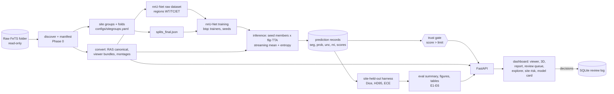

# Architecture

## Components
| Layer | Package | Responsibility |
|---|---|---|
| Data | `btqc.data` | Parse names (`discover`), read headers (`nifti_io`), reorient to RAS (`orient`), convert and bundle (`convert`), manifest (`manifest`), label conventions (`labels`), site groups (`sitegroups`), synthetic fixtures (`fixtures`), per-case standardization (`standardize`) |
| Training | `btqc.train` | nnU-Net dataset and splits (`nnunet_setup`, `splits`), CLI runner with MLflow (`runner`), custom trainers (`trainers/`, found through `nnUNet_extTrainer`), augmentations (`augment`) |
| Inference | `btqc.infer` | nnU-Net member wrapper (`predict`), flip TTA and member accumulation (`tta`), leakage-safe ensembles (`ensemble`), instance-norm TTA (`tta_adapt*`), record format (`record`), summaries (`postprocess`), rule-based examples (`example_rules`), synthetic stub (`stub`) |
| Uncertainty | `btqc.uncertainty` | Entropy and mutual information (`entropy`), case scores (`case_score`), calibration (`calibration`), failure detection and review-limit rule (`failure_detection`), trust gate (`gate`, stdlib only) |
| Evaluation | `btqc.eval` | Metrics, harness (`loso`), statistics, shift, summary, figures, tables, experiments E1-E6 (`runs`) |
| Serving | `btqc.serve` | FastAPI app (`api`), read-only store, schemas, SQLite review log |
| Frontend | `web/` | Vanilla ES modules, no runtime network: NIfTI reader (`nifti.js`), slice views (`viewer.js`), WebGL 2 ray caster (`render3d.js`), data sources (`data.js`), gate mirror (`gate.js`), SVG charts (`charts.js`), pages |

## Key design decisions
1. **One geometry rule everywhere.** Python (`orient.py`) and the browser (`nifti.js`) use the same dominant-axis permutation and sign rule. Every volume is stored once in canonical RAS with its original orientation, so the status bar can show the file's own voxel indices. Both directions are tested, including a planted voxel in the browser.
2. **One prediction record format.** Every predictor (nnU-Net members, the rule-based example, the synthetic stub) writes the same `.npz` + `.json` pair. The `source` field (`model`, `example`, `synthetic`) travels with it to the API and UI, which label everything that is not `model`.
3. **Members as a stream.** Uncertainty needs every member's probabilities, but holding 24 full-volume probability maps would not fit in memory. Running sums of probability and entropy give the predictive entropy and mutual information in constant memory.
4. **The gate is isolated.** `uncertainty/gate.py` imports only `math` and `dataclasses`. A test parses its imports, its signature is `(score, review_limit)`, and the browser mirror has the same semantics, including the fail-safe for NaN.
5. **Leakage is checked, not assumed.** Folds are validated (no overlap, no held-out-group case in train/val/in-site test). Ensembles are built from member indices of their own fold only. The harness refuses a record whose `fold` differs from the fold being scored.
6. **Honest outputs.** Every experiment script writes `status: "not run"` with a reason when its inputs are missing. The dashboard shows "not run" panels instead of placeholder numbers.

## Data flow at runtime (dashboard)
The browser fetches gzip uint8 bundles (`/api/cases/{id}/volume/{seq}`, metadata in the `X-Btqc-Meta` header), decompresses them with `DecompressionStream`, and renders them. The trust flag is recomputed in the browser from the score and the slider position with the same rule as the server. Local files opened in the viewer are parsed in the browser and never uploaded.
